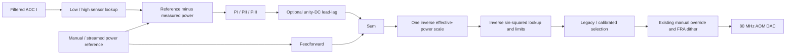

# Calibrated intensity servo (IS03)

This branch controls optical power with ADC224/1 and DAC228/3. The existing 90 MHz mixer LO, RFDC settings, 80 MHz AOM carrier, both laser PLLs, intensity phase calibration, and intensity FRA remain available. A new control bit selects the calibrated path; reset selects the original HLS PI. The existing manual-DAC override remains downstream of both controllers.

After downloading the matching bitstream/HWH, restore and verify the RFDC demodulator settings, mixer LO amplitude (`axi_gpio_12`), and demodulator phase correction (`axi_gpio_10`) used for the sensor calibration. The supplied `intensity_phase_calibration.ipynb` covers phase calibration. Match the physical PD attenuation to the selected sensor table before enabling the calibrated controller. Loading a saved sensor map does not restore the LO or demodulator configuration.

## Physical units and calibration

In the new path, a reference word is **unsigned optical power**. The updated notebook uses 65536 codes per **50 mW in low-power mode** and per **200 mW in high-power mode**, giving 0.76294 µW and 3.05176 µW per code. The previous common 200 mW scale remains supported. Both sensor and reference use the selected scale; Python switches the existing output multiplier consistently between shots. See [physical-power upload and mode switching](intensity_power_upload.md). A manual or streamed word has this meaning only when the new path is selected. The legacy path retains its original signed ADC-setpoint semantics. Do not reuse old ADC-count waveforms as optical-power waveforms without conversion.

Two independent monotone sensor lookup tables convert filtered ADC I to optical-power codes in the selected scale. The measurement reaching higher power is the high-power attenuation mode; both data sets used zero ADC bias. Software selects the map corresponding to the physical PD attenuation. The unknown two-point file is excluded. Samples outside a table's measured range clamp to the nearest calibrated value and carry a range flag; no dark-power value is invented. The zero reference is an independent hard-off command that resets feedback state.

The measured AOM logarithmic slopes are fitted to

\[
F(u)=\sin^2(\alpha u),\qquad \alpha=4.72156\times10^{-5}\ {\rm rad/code},
\quad \frac{d\ln F}{du}=2\alpha\cot(\alpha u).
\]

The actuator lookup implements the inverse `u = asin(sqrt(F))/alpha`. The default command limit is 21335, the highest measured command, corresponding to F≈0.7147. The predicted first maximum at about 33269 codes is outside the measured interval. Small-command behavior is also extrapolated below about 1119 codes. Zero is explicitly mapped to zero.

The model is not exact: integrated slope data agree with the fitted transmission shape to approximately 0.8% above 4000 codes after anchoring at 6000 codes, but the discrepancy reaches about 19% below 4000. See the [analysis and figures](../exports/intensity_servo_20261028/README.md). The Bayesian estimator initially excludes commands below 4000 and retains a model-uncertainty floor.

## Controller and feedforward

All feedback calculations use signed power codes with eight fractional bits. The controller definitions are explicit:

- PI: `Kp (1 + ω1/s)`.
- PII: `Kp (1 + ω1/s)(1 + ω2/s)`.
- PIII: `Kp (1 + ω1/s)(1 + ω2/s)(1 + ω3/s)`.

These are cascaded PI factors, not three unrelated integral gains. Positive Kp is negative feedback for an AOM whose power increases with command, because error is reference minus measured power. The original HLS controller used the opposite error sign; do not copy its negative Kp/Ki directly.

The proportional path runs at 245.76 MHz. Integral states update at 122.88 MHz, retain 32 fractional bits, and have individual saturation and directional anti-windup. They may unwind away from a rail. Additional registers are confined to the integral calculations so the fast proportional path stays short. Optional lead-lag is a unity-DC shelf, approximately `(1+s/ωzero)/(1+s/ωpole)`, with high-frequency gain `fpole/fzero`.

The command in normalized diffraction units is

\[
F_{\rm cmd} = \frac{P_{\rm ref} + C(P_{\rm ref}-P_{\rm meas})}{A_{\rm eff}}.
\]

Here all powers use the same units, such as mW, and `F_cmd` is dimensionless. Hardware stores power as a fraction of the common full scale, so its scale multiplier is `P_fullscale/A_eff`. Feedforward can be switched off. `A_eff` is the effective optical power scale in `P=A_eff F(u)`. It includes diffraction efficiency and downstream transmission; these measurements cannot isolate true incident AOM power. One common inverse scale corrects feedforward and feedback together. Applying an additional reciprocal correction to Kp would double-compensate the change. Static feedforward reduces servo effort; it does not cancel acoustic/transport delay or predict unmeasured disturbances.

The [tracking simulation](../exports/intensity_servo_20261028/tracking_simulation.md) compares feedforward on/off at identical controller settings and initial optical power. For the 150 kHz PI, feedforward reduces smooth-shot RMS error from **113.2 to 7.45 µW** (about 15×), but increases a mixed shot containing abrupt steps from **0.620 to 0.741 mW** because of greater overshoot. Steady detector-driven noise is essentially unchanged. These are model predictions using the measured delay and fitted AOM response, with separate quantization, ±5% optical-scale and timestep checks; they are not optical measurements. Feedforward improves the reference response without increasing feedback stability margins. The notebook initially leaves it **off** for the requested 300 kHz PI step test, and provides an explicit flag for later smooth-ramp comparisons. The simulation also shows that a +5% scale error can drive that narrow-margin 300 kHz setting into oscillation.

The implementation retains direct lookup tables: two 16K×16 sensor maps and one 64K×16 actuator map, totaling 192 KiB of table data. Calibration interpolation is performed in Python before loading; hardware performs indexed RAM reads. This uses more RAM than a segmented interpolator but keeps the arithmetic and latency simple.

An additional [pulse comparison](../exports/intensity_servo_20261028/setpoint_weighting_simulation.md) confirms that feedforward speeds the first edge: for the modeled 150 kHz PI, the first 10–90% rise falls from 0.701 to 0.207 µs, while step overshoot rises from 27% to 111%. Removing the proportional reference kick in an **offline-only** weighted-controller variant reduces overshoot to 79%; the integrator still charges during the propagation delay. Setpoint weighting is not implemented in this bitstream. These comparisons hold feedback gains fixed; they do not establish the best attainable feedforward tuning.

## Timing and gain recommendations

The supplied FRA was measured with the INT2 low-pass filter. Its power response `K=Q/(P0 U)` has an effective phase-slope delay of **1.087 µs**. This is a measured plant delay, including hardware and optical response between injection and the monitor; it is not just FPGA arithmetic. The old loop crosses unity near 178 kHz with approximately 34° phase margin in the measured band.

At 500 kHz, the measured plant contributes about −196° phase. A large lead setting can make an apparently attractive local crossing while introducing another unstable crossing. Consequently **a robust bandwidth above 500 kHz is not supported by these measurements**. Reducing the physical delay or substantially changing the compensation requires further measurements. The data also contain up to 50% optical modulation near resonance, so repeat at half and quarter amplitude before relying on a small-signal model.

Initial settings for the normalized optical-power controller are:

| Controller | Quantized Kp | Integral corners | Target crossover | Lead-lag |
|---|---:|---|---:|---|
| PI, requested experiment | 1.00830078 | 50 kHz | 300 kHz | bypass |
| PI, wider-margin fallback | 0.35278320 | 400 kHz | 150 kHz | bypass |
| PII | 0.35278320 | 400 kHz, 1 kHz | 150 kHz | bypass |
| PIII | 0.35278320 | 400 kHz, 1 kHz, 100 Hz | 150 kHz | bypass |

The refined [open-loop plots and all-crossing tables](../exports/intensity_servo_20261028/open_loop_predictions.md) include the relative integral/shelf registers in the two-phase linearized RTL recurrence. The requested PI preset predicts a **264 kHz** crossover and **61°** local phase margin, but only **0.19 dB gain-increase margin**. Its gain curve is nearly flat at unity: the earlier scalar controller approximation gave 299 kHz and 48°, despite only about a 0.31% magnitude difference. That sensitivity, and the larger experimental calibration uncertainty, make this an experimental setting rather than a demonstrated stable operating point. The earlier observation of more than 300 kHz bandwidth is not contradicted by this provisional, large-modulation FRA; measure the actual small-signal response again. The separate PI-plus-lead preset, which also changes the PI corner to 300 kHz, predicts 286 kHz, 45.6° phase margin and 0.64 dB gain-increase margin, still narrow. Preset coefficients are unchanged; older scalar estimates in their JSON remain approximate.

Simply enabling the 20/200 kHz lead shelf at the bypass gains adds almost 20 dB at high frequency and gives unsuitable gain margins for all three controllers. Lowering its Kp to normalize gain at the target frequency gives PII/PIII about 149 kHz crossover and 93.5° local phase margin, but only 2.85 dB gain-increase margin and less low-frequency rejection. Doing this with the 50 kHz-corner PI produces **three crossings**, including a later negative-phase-margin crossing; it is not a stable 300 kHz solution. Check every crossing rather than maximizing one local phase-margin number.

The lower-bandwidth PI, PII and PIII settings predict approximately 150 kHz crossover, 48–49° phase margin and 5.0–5.1 dB gain margin using the measured plant, quantized controller recurrence, ideal local linearization and the additional 44.76 ns digital-path budget. They are proposed starting points, not hardware-verified tuning. Start with reduced Kp and validate the FRA. Extra low-frequency integral factors improve rejection without adding a full 90° lag at crossover. Quantized coefficients and model details are in `controller_starting_points.json`. The notebook requires reviewed fresh FRA before optimization/adaptation, initially limits parameter steps to 0.5%, and does not automatically increase Kp beyond the tested baseline.

The fast feedback path has eleven register boundaries from the measured sensor tap to the recorded actuator tap: sensor lookup and output register 2, proportional controller 2, feedforward/feedback sum 1, scale multiplier 2, clamp/index 1, inverse lookup 1, lookup output register 1, and existing diagnostic output register 1. Budget **44.76 ns beyond the measured plant delay**, or 52.90 ns with the optional shelf. The conservative eleven-clock budget contributes 2.42° at 150 kHz, 4.83° at 300 kHz and 8.06° at 500 kHz. Exact edge-to-edge timing differs by one clock depending on the sample timestamp convention. After enabling, a control change or invalid ADC data, output admission waits thirteen clocks to cover the longest shelf-enabled pipeline; that guard adds no steady-state delay. Relative integral-side history contributes approximately 0.48° additional lag at 150 kHz for the proposed PII/PIII settings; the refined plots include it. The absolute eleven-clock system budget remains conservative rather than a separately measured converter timing reference.

The original IS03 release passes setup, hold and pulse-width timing: worst slacks are **+0.011 ns**, **+0.001 ns** and **+0.534 ns**, with zero failing endpoints and zero routing errors. These are full-project implementation results, not standalone RTL simulation. Existing clock/external-I/O constraint warnings remain; no new timing exceptions hide controller recurrence paths. The existing 15-tap receiver FIR is unchanged (44.76 ns added group delay relative to the former raw receiver).

The implemented calibrated controller, including both sensor maps, actuator map, PI/PII/PIII and shelf, uses **1,806 LUTs, 1,133 flip-flops, 45 BRAM36 equivalents and 9 DSPs**: respectively 0.42%, 0.13%, 4.17% and 0.21% of the ZCU216 device. Its shot sampler/FIFO/DMA are separate: 1,902 LUTs, 3,005 flip-flops and 6.5 BRAM36 equivalents before their control GPIO/interconnect overhead. The complete project uses 89,826 LUTs, 121,385 flip-flops, 404.5 BRAM36 equivalents and 426 DSPs. The release verification file records matched bit/HWH hashes and checks; physical optical-loop operation still needs hardware validation.

Acoustic propagation could dominate the measured delay. G&H's [1064 nm, 80 MHz TeO₂ AOMO 3080-199 datasheet](https://www.eqphotonics.de/wp-content/uploads/GH_AOM_3080-199_97-03012-01.pdf) specifies 4.2 mm/µs. A transducer-to-beam distance of 3–5 mm would therefore produce 0.71–1.19 µs; the full 1.087 µs measured delay corresponds to 4.57 mm if assigned entirely to sound propagation. This is a plausibility check, not identification of the installed model or a separation of electronic delay. The acoustic path to the beam sets the delay; transit across the beam sets additional smoothing/rise time. A 1 mm beam displacement along the sound direction changes delay by 238 ns and phase by 25.7° at 300 kHz for this TeO₂ model. G&H also makes [1064 nm quartz modulators](https://gandh.com/products/acousto-optics/modulators/i-m080-2c10g-4-am3), so verify the device label before using this velocity for alignment calculations.

The user recalls the model with the smaller diffraction angle. This points toward the quartz model but is not a confirmed identification: its specified zero-to-first-order separation is 14.9 mrad, versus 20.2 mrad for the TeO₂ model. From `v ≈ wavelength × RF_frequency / separation_angle`, the quartz specification implies about **5.7 mm/µs**. Then 3–5 mm acoustic travel takes 0.53–0.88 µs, still a plausible dominant share of the measured total. A 1 mm displacement toward the transducer would save about 175 ns, or 19° at 300 kHz. Do not use the Bragg angle (half the beam separation) in that calculation.

## Shot records and adaptation

The dedicated receive DMA is armed before the existing command DMA. Capture starts on the streamer's actual `active` rising edge and ends on its falling edge plus a programmable tail. DMA prefetch completion alone is not shot completion. Each frame contains:

| 32-bit word | Contents |
|---|---|
| 0 | signed error in power codes ×256 |
| 1 | reference power in low 16 bits, measured power in high 16 bits |
| 2 | actual actuator code in low 16 bits, signed raw ADC I in high 16 bits |
| 3 | diagnostic flags in low 16 bits; high bits reserved |

Flag bits are actuator clipping, sensor outside calibration, controller saturation, invalid ADC, legacy path active, and configuration change. Flags are accumulated between saved samples. The monitor never backpressures the servo. Overflow or truncation makes a record unsuitable for optimization; the data remain available for diagnosis.

At D=6 the saved rate is 3.84 MS/s. A 100 ms shot plus 1 ms tail occupies about 6.2 MB in the DMA buffer. Saved NPZs also include derived physical-unit arrays, so their size depends on compression. This is point decimation, not a new anti-alias filter: it is useful for spotting 500 kHz ringing, but arbitrary noise above Nyquist can alias. Use a shorter fast capture when that matters. Preserve the sample rate and flags with every record.

The Python optimizer compares repeated identical reference waveforms and calibration modes using RMS calibrated optical tracking error in mW as its sole cost. Overshoot and ringing are separate diagnostics, not weighted additions to the objective. Repeated-shot cost is the square root of the mean squared per-shot RMS values. Trials stay within explicit parameter bounds and are proposed between shots; it does not infer stability from one quiet record. Dark intervals are excluded from calibrated-power statistics because no dark sensor point was measured; actuator-off behavior is checked separately. At startup, up to 10 µs of below-range samples and one flagged boundary interval can be excluded, with a default hard limit of 0.1% of illuminated samples. Excluded time is reported; it is not assigned invented power values. Other faults reject the trial.

The scalar Bayesian estimator uses settled illuminated plateaus to infer log(A_eff). It rejects clipping, calibration violations, large transients and outliers. Its process noise allows slow drift; a calibration/model floor prevents unlimited confidence from repeated biased observations. Optional bounded between-shot updates change the single inverse-power scale after controller optimization. Configuration, prior/posterior and applied changes are saved so the experiment is reproducible. No mid-shot parameter writes are permitted.

## Register interface and modules

`intensity_linearized.sv` owns the two input RAMs, actuator RAM, write guards, physical-unit error and feedforward sum. Full sequential table uploads are required before enabling; coefficient/LUT writes are rejected while the calibrated path or shot streamer is active. The legacy datapath is a direct mux input. `intensity_linearized_wrapper.v` is the Vivado boundary.

`intensity_compensator.sv` contains the PI cascade and optional lead-lag. Integral multiplier/history registers do not lengthen the proportional feedthrough. `intensity_shot_capture.sv` is an independent nonblocking sampler with one-frame lookahead to emit TLAST at the real shot end; its wrapper carries the AXI-stream interface. The existing `intensity_probe.sv` still supplies sample-resolved FRA and manual output.

The three servo GPIOs are `intensity_servo_control`, `intensity_servo_write`, and `intensity_servo_read`. Control bits: 0 select new path; 1 feedback; 2 feedforward; 3 high-power sensor; 4 lead-lag; 5 hold integral states; 6 reset states; 8:7 integral order. All other bits are reserved.

Write GPIO channel 2 contains data. Channel 1 contains the 18-bit address and a toggle in bit 31: write data first, then flip the toggle for each write. The read GPIO channel 1 reads the selected coefficient/status address; channel 2 is signature `0x49530301`. LUT ranges are low sensor `0x00000–0x03fff`, high sensor `0x04000–0x07fff`, output `0x10000–0x1ffff`. Tables have no third RAM port for readback; software records their hashes and hardware verifies complete sequential load counts.

Registers at `0x20000 + offset` are Kp (0, signed Q12), integral increments (1–3, unsigned Q24), shelf alpha (4, Q30), shelf high-frequency gain (5, signed Q12), inverse effective-power scale (6, unsigned Q20), low/high sensor bounds (7–8, low/high packed 16-bit), maximum normalized output index (9), maximum DAC command (10), configuration epoch (11, read-only), and completed low/high/output table write counts (12–14, read-only).

Use `python_scripts/intensity_servo.ipynb` for annotated setup, calibration loading, controller choices, FRA, shot capture, optimization and drift adaptation. Helpers refuse updates that could silently reinterpret an active waveform. Other channels' software remains unchanged.
