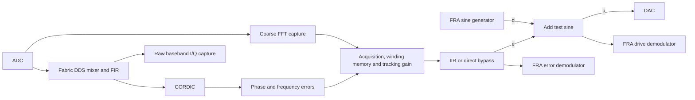

# A7: two optical PLLs, loop measurements and selectable lead–lag

This revision adds an independent ADC 225/1 → DAC 229/3 loop, improves the FRA measurement diagnostics and averaging, and adds an optional first-order compensator to **both** error paths. The FPGA signature is **0xA7**. Load the matching bitstream, HWH and both Python helpers. The A6 archive retains the previous single-PLL hardware.

The two PLLs have separate DDS phase accumulators, acquisition/slip memory, tracking gain, DC test, I/Q monitor DMA, FRA generator/demodulators and IIR state. Neither software selection nor configuring the second loop switches the first loop's ADC/DAC. The original transport logic and ADC 225/0 and 225/2 retain their connections and rates. Converter tiles, fabric clock, memory interconnect and PS are still shared.

Each optical loop uses this signal path:



## RF frequencies and channel selection

| Loop | ADC | DAC | Default RF reference | Sampled reference | ADC rate |
|---|---|---|---:|---:|---:|
| `ol` | 224/3 | 229/1 | 800 MHz | 800 MHz | 1.96608 GS/s |
| `ol2 = laser_pll.channel(ol, 1)` | 225/1 | 229/3 | 4.4 GHz | 467.84 MHz | 1.96608 GS/s |

For loop 2, `f_alias = f_RF − 2*f_ADC`. The default lies in physical Nyquist zone 5 (3.93216–4.91520 GHz), so the real sampled tone has the **same phase direction** as a first-zone positive-frequency tone. `set_reference_frequency(ol2, ...)` accepts physical RF frequency, commits the aliased 48-bit DDS word, and returns the physical RF frequency. FFT status also reports physical RF frequency. Changing the reference preserves fabric DDS phase by default.

The 4.4 GHz default is not hardwired. For example, a 4.2 GHz reference aliases to 267.84 MHz and still leaves ±100 MHz within this band; select a physical carrier that the connected RF front end passes.

At 4.0 GHz the alias would be only 67.84 MHz, with a folding boundary 67.84 MHz below the carrier and a nearby mixer image. At 4.4 GHz the alias is 467.84 MHz: ±100 MHz is inside one Nyquist band, within the existing fine detector's intended capture range, and well separated from that image. RTL tests synthesize the actual sampled 4.3, 4.4 and 4.5 GHz tones and verify fine phase and capture polarity. The FPGA cannot distinguish different physical RF frequencies that alias to the same sampled tone. The dominant input tone must be in the intended RF band, and the analog input chain must pass it.

The RFDC ADC mixer remains bypassed; coherent quadrature mixing remains in fabric. Both DAC paths use the established zero-frequency C2R format at 6.88128 GS/s, interpolation 4, seven repeated `(I=error,Q=0)` pairs per fabric clock. Configuring `ol2` updates only DAC tile 1/block 3's mixer. Tile sample rates are unchanged.

AMD's [Nyquist-zone API](https://docs.amd.com/r/en-US/pg269-rf-data-converter/XRFdc_SetNyquistZone) uses **1=odd, 2=even**, not the literal higher-zone number. The GUI's `ADC_Nyquist=0` corresponds to odd zones; do not write `5` to the driver. The new ADC uses GUI calibration setting 2, as the existing laser channel does.

```python
import importlib
import laser_pll
import laser_pll_loop_sweep as fra
laser_pll = importlib.reload(laser_pll)
fra = importlib.reload(fra)
fra.laser_pll = laser_pll  # also required if you renamed the control helper

# `ol` is the already loaded A7 Overlay. This line only selects handles.
ol2 = laser_pll.channel(ol, 1)
assert (ol2.pll_acquisition_status.read(8) >> 24) == 0xA7

# Configure the second loop while its analog acquisition is prepared.
# This mutes/resets only that loop's detector; it does not configure loop 1.
laser_pll.configure(ol2, reference_frequency_hz=4.4e9,
                    phase_gain_shift=0, capture_gain_shift=6,
                    minimum_amplitude=64, invert=True)
laser_pll.configure_acquisition(ol2, stage=1, minimum_fft_peak=32)
laser_pll.enable(ol2)
print(laser_pll.acquisition_status(ol2))
```

Use the same established acquisition sequence: stage 1 with the slow controller; stage 2 near the reference; stage 3 for unwrapped /160 acquisition and then fast-loop engagement. After phase lock, stage 4 permits smooth sensitivity increases. Each command below is a separate experimental step, not an automatic optical-lock detector:

```python
laser_pll.select_stage(ol2, 2)
```
```python
laser_pll.select_stage(ol2, 3)
```
```python
laser_pll.set_tracking_gain(ol2, 0, wait=False)
laser_pll.select_stage(ol2, 4)
# Once stable, increase gradually; controller gain still matters.
laser_pll.set_tracking_gain(ol2, 1)
```

`laser_pll.capture_iq(ol2, ...)`, `set_dc_output(ol2, ...)` and all status functions use the second loop's hardware. I/Q remains post-mixer/FIR and **before** CORDIC, detector scaling and the new IIR. Two simultaneous large DMA captures share DDR bandwidth; lost samples are reported by the existing monitor checks.

## Lead–lag compensator

`laser_pll_iir.sv` implements

```
x[k] = mean of two adjacent 245.76 MS/s error codes
y[k] = b0*x[k] + b1*x[k-1] - a1*y[k-1]
H(z) = (b0 + b1/z) / (1 + a1/z)
f_update = 122.88 MHz
```

The filter is after acquisition/tracking/handoff and before FRA injection. Thus `L=-E/U` includes the selected compensator as well as the active discriminator and analog return path. The upstream 24-bit phase winding memory is unchanged. The unwrapped phase still rails the output when the memory becomes large; the IIR is a bounded voltage compensator, not a replacement slip accumulator.

| Property | Implementation |
|---|---|
| Bypass | Direct combinational selection; **zero additional clock cycles** |
| IIR update | Every second 245.76 MHz clock; DAC command held between updates |
| Added IIR pipeline latency | **2–3 RF clocks = 8.14–12.21 ns**, depending on the arrival relative to the update phase |
| Low-frequency equivalent added delay | Approximately 3 RF clocks = 12.21 ns, including the input pair average and output hold; about 4.39° at 1 MHz, before the intended lead/lag phase |
| Coefficients | `b0,b1`: signed Q5.27; internal pole `p=-a1`: signed Q1.31 |
| Recursive state | Signed 40 bits, 24 fractional DAC-code bits |
| Arithmetic | Full registered products; wide sum; round to state precision; saturate instead of wrap |
| Output | Round to signed 16-bit DAC code, saturate; physical DAC retains its existing resolution |
| Standalone implementation | 8 DSPs, 324 LUTs, 125 registers; routed setup/hold +0.309/+0.055 ns at 245.76 MHz |

The recursive state retains 24 fractional bits to keep low-corner rounding small. A worst-case steady rounding bound is `0.5*2**(-24)/(1-abs(p))` DAC codes: about 0.024 code at a 24 Hz pole (before the final integer rounding).

The two-clock recurrence is deliberate: one edge computes the three products; the next edge sums and saturates them. It avoids a long recursive multiply-plus-add in one clock without adding delay to bypass. Before each update it averages the two adjacent error codes, retaining the half-code bit in the multiplier. This suppresses noise near 122.88 MHz that would otherwise fold into the low-frequency loop band. Its two-tap response is `cos(pi*f/245.76e6)` with half a clock of group delay; near 122.88 MHz ±1 MHz, attenuation is about 38 dB. It is a minimal alias-suppression filter, not a steep general-purpose decimator. There is no averaging in bypass.

Filter operation continues in bypass. Coefficient writes are staged in two GPIOs and latched together by a commit toggle. The helper permits coefficient changes only in bypass and with the FRA stopped. Commit initializes state from the current input, exact for a constant signal and unity DC gain; wait for the indicated settling time before selecting a different DC gain. Selection itself is immediate, **not a crossfade**: a steady unity-DC lock point is preserved, but a varying input can step because filtered and bypassed signals differ.

`configure_lead_lag` starts from

```
H(s) = dc_gain * (1 + s/(2*pi*zero_hz)) / (1 + s/(2*pi*pole_hz))
```

and applies the bilinear substitution at **122.88 MS/s**, without corner prewarping. `zero_hz < pole_hz` gives phase lead and higher high-frequency gain; reversing them gives lag and reduced high-frequency gain. Coefficient quantization is reported, and the small numerator sum is matched to the pole to preserve DC gain. The conventions follow the [SciPy bilinear transform](https://docs.scipy.org/doc/scipy/reference/generated/scipy.signal.bilinear.html). Corners are restricted to ≤10 MHz and representable stable coefficients. Very low corners or large gain ratios can exceed fixed-point limits and raise before writing coefficients.

```python
import time
loop = ol                    # or ol2
laser_pll.enable_iir(loop, False)  # zero-added-clock path

# First verify selection with a unity transfer function (equal corners).
coeff = laser_pll.configure_lead_lag(loop, zero_hz=100e3, pole_hz=100e3)
print(coeff)                 # quantized b0, b1, a1, DC gain and settling time
```

```python
time.sleep(coeff["settle_time_s"])
laser_pll.enable_iir(loop, True)
# Return to minimum latency:
# laser_pll.enable_iir(loop, False)
```

For a chosen compensation after examining a measured loop response:

```python
laser_pll.enable_iir(loop, False)
# Example only: ~5x high-frequency gain and phase lead between 20 and 100 kHz.
# This changes total loop gain; it is not a recommendation for the current FALC settings.
coeff = laser_pll.configure_lead_lag(loop, zero_hz=20e3, pole_hz=100e3)
time.sleep(coeff["settle_time_s"])
laser_pll.enable_iir(loop, True)
```

To provide coefficients directly, call `set_iir_coefficients(loop,b0=...,b1=...,a1=...)`. Design them for **122.88 MS/s**. Changes while the filter is selected are rejected. Filter saturation is included in FRA internal-saturation diagnostics. Use bypass for a literal DC-code test of the analog output stage.

## FRA changes and interpretation

The old hardware latched one clipping flag throughout ramp-up, settling, integration and ramp-down. It also combined internal discriminator saturation with clipping in the final `error + injection` adder. A bounded scope trace could therefore coexist with the flag. A7 separates these cases:

- `dac_clip_samples`: number of measured RF-clock samples where `error + injection` exceeds the DAC code range.
- `detector_saturated_samples`: measured samples with saturation reported upstream, including the selected IIR.
- `outside_clip_samples`: events during ramp/settling/drain; reported but do not veto a clean integration window.
- `measured_samples`: actual window length, checked against the request.
- `error_range_codes`, `drive_range_codes`: signed minimum/maximum over the integration window.

Counts are per 245.76 MHz clock and freeze after the run. With the IIR selected, a held clipped sample can count twice. Internal and DAC counts may overlap; do not add their fractions as if disjoint. Internal clipping can occur before a handoff offset brings the final output away from a rail. A7 diagnoses that condition rather than hiding it.

For an unclipped point, the helper additionally checks that the measured difference `U-E` agrees with the requested injection amplitude and phase. A failed check stops the measurement rather than presenting a plausible-looking ratio from mismatched probes.

The HLS demodulators already integrate full-rate products with matched sine/cosine references. Downsampling alone does not improve that estimator. A7 instead:

- Raises the default minimum integration from 20 ms to **200 ms**, still approximately whole cycles, and keeps 16 cycles minimum at low frequencies.
- Averages at least **four complex phasor pairs**, extending up to twelve if repeat scatter is too large. It forms the ratio after averaging, not an average of noisy ratios.
- Alternates probe polarity and normalizes the returned phasors. This can reduce repeatable injection-independent offsets; arbitrary laser disturbances still contribute noise.
- Skips clipped blocks by default, records them, and continues to later frequencies. A frequency with too few clean blocks is marked unreliable/NaN instead of aborting the whole sweep.
- Saves every block, extrema, clipping counts, scatter, settings and accepted/rejected status to a companion CSV. `allow_clipping=True` retains clipped blocks but labels the result unreliable.

For stationary uncorrelated noise, a 200 ms rectangular demodulation window has single-quadrature equivalent noise bandwidth approximately **2.5 Hz**, versus 25 Hz before. Four such blocks contain about 13.3 times the integration of the old three 20 ms blocks; ideal random-noise standard error drops by about **3.65×**. Slips, coherent background lines, drift and clipping do not necessarily follow that scaling.

When loop gain is large, the response `U` at the DAC command can be very small. Then dividing by `U` amplifies measurement noise. Inspect `drive_stderr_codes` and `reliable`; a large, erratic `L` is not by itself evidence of a physical resonance. Increasing excitation may help, but compare half amplitude to check linear response. The helper does not increase injection amplitude automatically.

```python
loop = ol                    # or ol2, already locked; keep analog settings fixed
point = fra.measure_point(loop, 1e3, amplitude_codes=32,
                          minimum_measure_s=0.2, allow_clipping=True)
print(point["diagnostics"])
print("L:", -point["error"]/point["drive"])
```

```python
from pathlib import Path
from datetime import datetime
import numpy as np
path = Path(f"laser_loop_A7_{datetime.now():%Y%m%d_%H%M%S}.csv")
rows = fra.sweep(loop, np.geomspace(20, 1e6, 61), amplitude_codes=32,
                 repeats=4, max_repeats=12, minimum_measure_s=0.2,
                 allow_clipping=False, csv_path=path)
print(path.resolve())
print(path.with_name(path.stem + "_blocks.csv").resolve())
```

`measure_point` is strict unless its override is given. `sweep` may omit contaminated blocks and proceed; invalid phase, DAC stalls, monitor sample loss, generator gaps or aborts still stop it. Cleanup ramps down only the test tone and leaves both optical feedback states intact. The current helper includes the IIR settings in its configuration snapshot and rejects measurements spanning a setting change.

## Added GPIO registers

Each dual-channel AXI GPIO uses offsets **0x00** and **0x08** for the two data words. The Python helpers handle these registers; this table is for debugging. Names start with `pll_` on the original loop and `pll2_` on the second loop.

| Suffix | Original base | Second-loop base | Word at 0x00 | Word at 0x08 |
|---|---|---|---|---|
| `fra_counts` | `0xA02A0000` | `0xA10D0000` | Measured DAC clipping count | Measured internal saturation count |
| `fra_extrema` | `0xA02B0000` | `0xA10E0000` | Error extrema | Drive extrema |
| `fra_samples` | `0xA02C0000` | `0xA10F0000` | Outside-window clipping count | Integrated sample count |
| `iir` | `0xA02D0000` | `0xA1100000` | Control | Status |
| `iir_feed` | `0xA02E0000` | `0xA1110000` | `b0`, signed Q5.27 | `b1`, signed Q5.27 |
| `iir_pole` | `0xA02F0000` | `0xA1120000` | `p=-a1`, signed Q1.31 | Unused |

Extrema pack signed minimum in bits 15:0 and signed maximum in bits 31:16. IIR control bit 0 selects the filter, bit 1 is the coefficient-commit toggle. Status bits 0–3 are selected, commit acknowledgement, saturation and valid respectively. Write all three coefficient words before toggling commit; selecting a filter does not itself commit coefficients. Reset selects bypass and internally initializes unity coefficients. The FRA diagnostic words are read-only and freeze after a measurement; reading them does not clear them. IIR status is live.

## Pipeline and verification

The original fast path is unchanged up to the acquisition handoff. With IIR bypassed, ADC-word acceptance to the existing DAC register is 18 clocks for legacy/stage 2, 20 for stage 3, and 23 for tracking stage 4. The FIR's 7.884 ns group delay and RFDC/analog delays remain additional. Selecting IIR adds the 2–3 clocks above; FRA adds no pipeline registers to the feedback path. FFT and DMA remain independent side paths.

Tests include actual Vivado xsim execution of the original HLS generator/demodulators against a known delayed feedback loop, both stimulus polarities, exact integration counts, settling-only clipping, seven-cycle internal saturation with a bounded output, true DAC clipping, abort and monitor backpressure. The IIR RTL is checked against a floating-point recurrence, direct bypass and both rail polarities. Full PLL tone tests include 4.4 GHz and ±100 MHz, alongside the existing acquisition, winding-memory, tracking-ramp and DMA tests. Python tests exercise channel isolation, RF-to-alias units, coefficient stability/quantization, adaptive repeats, clipped-block rejection and notebook execution.

Full-project routing on October 12, 2026 meets the specified timing constraints: **setup +0.097 ns, hold +0.010 ns and pulse width +0.534 ns**, with zero failing endpoints, zero routing errors and no bus-skew violations. The worst setup path runs from the original loop's IIR state to its FRA drive-extrema monitor. The two integrated IIR instances each use 8 DSPs, 349–350 LUTs and 257 fabric registers; they use no block RAM. Their standalone figures above differ because register mapping and optimization change in the complete design.

| Complete board design | Used | Device capacity | Used fraction |
|---|---:|---:|---:|
| LUTs | 80,087 | 425,280 | 18.83% |
| Fabric registers | 106,620 | 850,560 | 12.54% |
| Block RAM, 36-Kbit equivalents | 335.5 | 1,080 | 31.06% |
| DSPs | 378 | 4,272 | 8.85% |

The exported package's `verification.json` records file hashes and verification results. Existing clock/external-I/O constraint limitations remain as documented in the main guide. Neither simulation nor routed timing certifies optical-loop stability; the FRA and output-stage tests remain the bench checks. Hardware has not been programmed by these build scripts.
