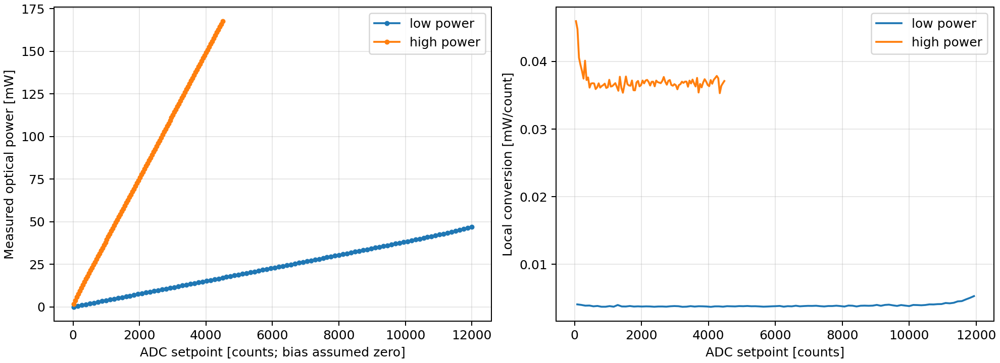
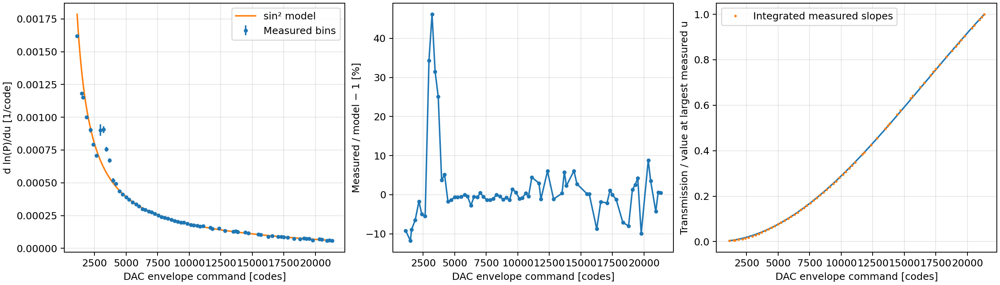
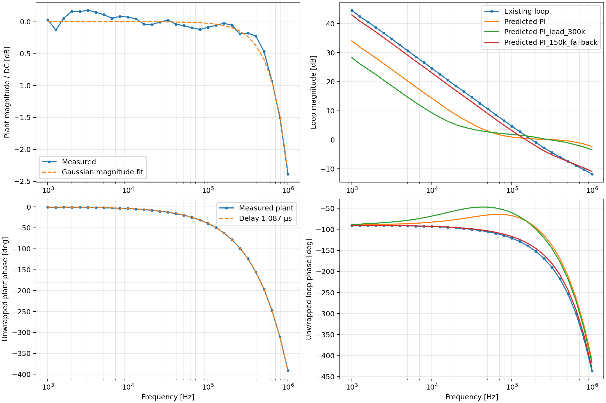

# Intensity measurements, 28 October 2026

This directory contains reproducible fits to the six CSV files in
`ILAData/10-28`. Run `python exports/intensity_servo_20261028/analyze_intensity.py`
from the repository, or run that script by absolute path. It needs NumPy,
SciPy, Pandas and Matplotlib. The input files are never changed. Their SHA-256
hashes are recorded in `source_hashes.json`.

For the final registered-controller response, see the [full open-loop Bode
comparison](open_loop_predictions.md), including fixed-gain shelf toggles,
gain-normalized alternatives, and a crossover zoom. Its two-phase RTL model
supersedes the simpler scalar-controller margin estimates below; it does not
change the programmed coefficients. The [feedforward tracking
simulation](tracking_simulation.md) compares smooth ramps and abrupt steps,
and the [PI pulse/setpoint-weighting study](setpoint_weighting_simulation.md)
examines a possible alternative reference path. These are model predictions,
not new hardware measurements or implemented setpoint-weighting changes.

## Sensor inverse functions

The user confirmed **ADC bias zero** for both tables and that the table
reaching higher optical power is the high-power mode. ADC setpoints are
interpreted as settled raw ADC I counts.

| Mode | Source suffix | ADC range | Measured power range |
|---|---|---:|---:|
| Low power / more sensitive sensor | `170653Z_8474d579.csv` | 20–12000 counts | 0.09243–46.9793 mW |
| High power / less sensitive sensor | `164507Z_a636b153.csv` | 20–4500 counts | 1.81379–167.623 mW |

The names follow the power obtained per ADC count and the user's confirmation;
the CSVs themselves do not encode the switch positions. `sensor_low_power.json` and
`sensor_high_power.json` retain all 100 measured points per mode, in mW, with
`mode_assignment_confirmed: true`. Linear interpolation is physically
transparent and avoids fitting away measured mixer/sensor curvature. Do not
extrapolate a table above its calibrated ADC range.

The third file (`145105Z_02e81cf4.csv`) contains only two nearly constant
readings, 18.07 and 18.29 µW, at setpoints 500 and 1000. It is **not an invertible
sensor calibration** and was excluded. Neither full sweep contains a measured
zero-light point, so no dark subtraction has been invented.

Using one common 200 mW full-scale power coordinate gives 3.052 µW per 16-bit
code. Near the bottom of the low-power calibration, one ADC count corresponds
to about 4 µW, so this power quantization is comparable to the current sensor
quantization. The supplied data do not demonstrate sub-µW accuracy or validate
the dark end of either mode. A different common scale is possible if the high
power limit changes; both maps, waveform units, controller units and estimator
must use the same scale.

## AOM response

`aom_signed_slopes.csv` and `aom_signed_slopes (1).csv` are byte-for-byte
duplicates, not independent repeat measurements. They contain 68 bins over
1119.39–21335.00 DAC envelope codes.

For a Bragg AOM with RF envelope voltage proportional to DAC command `u`, the
ideal first-order response is

\[
 P(u)=A_{\rm eff}\sin^2(\alpha u),\qquad
 K(u)=\frac{d\ln P}{du}=2\alpha\cot(\alpha u).
\]

The square root in the usual `sin²(constant × sqrt(RF power))` expression is
important: `u` controls RF **amplitude**, so the argument is linear in `u`, not
in `sqrt(u)`. This assumes the RF amplifier remains linear in envelope
amplitude. [ISOMET's modulation application note](https://isomet.com/App-Manual_pdf/AO%20Modulation.pdf)
and [RF-driver instructions](https://isomet.com/App-Manual_pdf/RFA240%28250%29-2-inst_iss2.pdf)
give this dependence.

A robust fit to relative slope residuals gives:

- `alpha = 4.72156e-5 rad/code`.
- The bin-resampling 95% interval is approximately `(4.610, 4.848)e-5`; it
  excludes systematic sensor calibration and model errors.
- The fitted first maximum is at **33269 codes**, outside the measured range.
  It must not be treated as a validated operating limit.
- At the largest measured command, `sin²(alpha*u) = 0.714730`.
- Fractional slope residual RMS is 7.47% over all points, and 3.46% above
  4000 codes. Around 3000–3700 codes the measured slope exceeds the model
  substantially; at the worst point the model underestimates the measured
  slope by 31.6% (equivalently, measured/model is 46% high).

Adding an envelope offset does not produce a robust physical parameter:
depending on weighting and fit range the fitted offset moves by more than
100 codes. The recommended model keeps the offset at zero. A single `sin²`
fit therefore supplies a useful first correction, not an exact inverse of
every measured feature. Feedback should correct the remaining model error;
do not let an adaptive estimator mistake the systematic 3000-code feature
for a change in incident laser power.

Slope error is not the same quantity as power error. Integrating the measured
slopes and anchoring both curves at 6000 codes gives relative-transmission
disagreement of approximately −0.70% to +0.79% above 4000 codes, but down to
−19.1% below that range. This is an internal shape-consistency comparison,
not an absolute efficiency or accuracy measurement; common sensor-calibration
errors and integration uncertainty remain.

The inverse is

\[
u=\frac{\arcsin\sqrt{P_{\rm cmd}/A_{\rm eff}}}{\alpha}
\]

on the rising branch, with explicit command limiting. Keep the initial limit
at the measured upper endpoint, approximately **21335 codes**. `u=0` may be a
deliberate off command; intermediate values below 1119 codes are model
extrapolation and were not measured here.

`A_eff` is the optical scale at the power-meter/sensor plane. It combines AOM
input power, peak diffraction efficiency and collection losses. The data do
**not** independently identify true AOM input power or absolute diffraction
efficiency. The FRA operating point implies `A_eff ≈ 184 mW`, conditional on
the sensor table and the `sin²` model used for that measurement. This is a
consistency estimate, not a fixed hardware calibration.

## Transfer function and effective delay

The one FRA file is `intensity_loop_171424_945111.csv`, covering 31 frequencies
from 1 kHz through 1 MHz with a 500-code programmed sine. Its definitions are:

- `C`: selected controller-command phasor, before diagnostic sine addition.
- `U`: actual DAC-command phasor after addition and limiting.
- `Q`: calibrated optical-power phasor.
- `L = -C/U`: measured loop return ratio.
- `K = Q/(P0*U)`: fractional optical response per actuator code.

The phase slope of **K**, not L, estimates the plant delay without incorrectly
including the PI's integrator phase. Its unwrapped phase is extremely close
to linear. Fitting 50 kHz–1 MHz gives

\[
\tau_{\rm eff}=1.0871\ \mu\mathrm{s}.
\]

Different fit windows give 1.0866–1.0875 µs. The formal regression standard
error is about 0.36 ns for the chosen window; that small number describes
fit residuals only. It does **not** establish sub-ns absolute calibration of
the loop. The robust engineering interpretation is **about 1.09 µs**.

This effective group delay runs from the recorded DAC command through the
DAC, RF amplifier/AOM, optical path, photodetector/mixer, ADC, and receive
filter back to the recorded sensor value. It includes any relative timing
of those monitor taps. The probe records command and sensor in the same
stream frame; subsequent DMA transport and Python fitting do not add delay
to the ratio. Using the same recorded DDS phase for both phasor fits also
cancels any common reference-phase offset.

This is **not** a measurement isolating pure electrical propagation, AOM
acoustic transit, RFDC latency, or the new controller latency. The acquisition
firmware and RF/controller settings were not embedded in this CSV, but the
user confirmed the **INT2 receive FIR was included**. Do not add its 44.76 ns
twice. Add only the
new controller's actual reference-to-actuator processing delay when assessing
the proposed implementation.

The magnitude is nearly flat below a few hundred kHz and down approximately
2.4 dB at 1 MHz. A descriptive Gaussian magnitude fit has 1/e frequency
1.925 MHz; this is consistent with finite acoustic transit across the optical
beam but does not prove that mechanism. The fitted DC fractional sensitivity
is `K0 = 3.29623e-4 /code` at this operating point.

All 31 rows have the helper's statistical reliability flag. However, the
measured peak optical modulation reaches **50.4% of mean power** near the
loop resonance. Statistical reliability is not a test of small-signal
linearity. Repeat at half, and preferably quarter, amplitude before treating
the extracted gains/margins as final. The phase-delay fit is much more
internally consistent than an arbitrary pure-delay assumption, but it too
deserves this check. No frequency above 1 MHz or below 1 kHz was measured.

The measured existing loop has, using log-frequency interpolation:

- Unity crossover approximately **178 kHz**.
- Phase margin approximately **34°**.
- First phase crossing approximately **284 kHz**, gain margin **3.64 dB**.

These modest margins are consistent with pronounced ringing sensitivity.

## Controller starting values

The proposed power-linearized feedback uses the same optical units for error
and controller output. Its normalized plant is `H(f)=K(f)/K0`, with DC gain
approximately one once the inverse maps and effective optical scale are
correct. Positive controller gain assumes `error = reference − measured`.

Use the inspectable cascade convention

\[
C(s)=g\prod_{j=1}^{N}\left(1+\frac{2\pi f_{Ij}}{s}\right),\qquad N=1,2,3.
\]

The user has already demonstrated above300kHz bandwidth with PI. The next
PI experiment therefore targets **300kHz**, while PII/PIII use a lower-bandwidth
starting point with substantially wider predicted gain margin. This respects
the observed operation; the original500-code FRA is not a definitive
small-signal characterization of every operating point.

| Selectable preset | Actual quantized g | Integrator corners | Earlier scalar crossover | Scalar PM | Scalar GM |
|---|---:|---|---:|---:|---:|
| PI: requested300kHz trial | 1.008301 | 50kHz | 299kHz | 48.1° | 0.166dB |
| PII: lower-bandwidth start | 0.352783 | 400kHz,1kHz | 150kHz | 48.4° | 5.05dB |
| PIII: lower-bandwidth start | 0.352783 | 400kHz,1kHz,100Hz | 150kHz | 48.4° | 5.05dB |
| PI150kHz fallback | 0.352783 | 400kHz | 150kHz | 48.8° | 5.06dB |
| PI plus lead300kHz trial | 0.086426 | 300kHz; shelf zero20kHz,pole200kHz | 298kHz | 41.5° | 0.551dB |

This table retains the earlier **quantized half-rate product approximation**
used when choosing the presets. It includes the measured plant and the
11-clock44.76ns main path, but omits the relative integral-side registers.
The [refined Bode report](open_loop_predictions.md) includes those registers
and was independently checked against the bit-exact sequential controller
reference to approximately1×10⁻⁶ relative complex error at the checked points.
For unchanged gains it predicts PI crossover264kHz, local PM61°, and only
0.194dB gain-increase margin; PII/PIII give149.4kHz, PM48.09°/48.05°, and
about5.09dB gain margin. The PI crossing shifts considerably because a mere
0.31% controller-magnitude correction matters on its nearly flat unity-gain
curve. This is model sensitivity, not a measured hardware-bandwidth change.
The scalar margins in `controller_starting_points.json` are approximate;
use `open_loop_predictions.json` for the refined response. Coefficients are
unchanged. Both models still require a fresh small-signal FRA.
The shelf adds two more clocks8.14ns, for52.90ns total. The actuator-table and sensor-table
output registers added during timing closure are included here. All gains use optical error/output in
the same units; do not copy the previous raw-count HLS PI gains.

For PI300kHz the programmed values are Q12g=4130 and Q24 integral increment
42893. PII/PIII use Q12g=1445, with Q24 increments343146,858,and86 as applicable
at122.88MHz. The lead alternative uses Q12g=354, PI increment257359,
Q12 shelf gain40960, and Q30 shelf alpha10924706. Exact values, all crossings
and sensitivity maxima are exported in `controller_starting_points.json`.

**Local phase margin is not the whole limitation here.** The measured plant
magnitude is almost flat between300kHz and its later phase crossing. Thus
a300kHz PI unity crossing can have48.1° phase margin yet only0.166dB gain margin:
about2% more total loop gain reaches the model's oscillation threshold near
423kHz. The interpolated model predicts a large sensitivity peak, around53,
there. The optional lead reduces that peak to roughly16 and increases gain
margin to0.55dB, but is still a narrow-margin experiment. A one-shelf grid
search did not reveal a wide-margin300kHz solution for this measured plant.
A comparison lag option (5kHz PI corner, zero400kHz/pole270kHz) gives about
44.1°PM and0.59dBGM while sacrificing low-frequency rejection; it is exported
for comparison, not selected automatically.

The small margins are comparable to calibration, operating-point and
large-dither uncertainties. They do **not** certify instability of the user's
previous300kHz configuration, nor prove that the new linearized loop has
those exact margins. A fresh low-amplitude FRA is the decisive check. Measure
through at least1MHz, inspect **all** unity and negative-real-axis crossings,
and compare half-amplitude repeats. No stability margin above the measured
band is established. PII/PIII slow poles also need shot testing and, if their
low-frequency dynamics matter, measurements below the current1kHz limit.

Keep the requested300kHz PI as a selectable trial and the150kHz presets as
fallbacks. The notebook requires a reviewed-FRA flag before automatic tuning;
initial coordinate steps are0.5%, with no automatic upward Kp change beyond
the tested baseline. Power adaptation is initially limited to0.5% per shot
and separately gated by reviewed FRA and controller verification. A small
step limit alone does not establish safe cumulative adaptation. Recheck after
large optical-power changes or a sensor attenuation-mode change.

### Why >500 kHz is not established by these measurements

At 500 kHz the measured plant alone has about **196°** lag, and at 550 kHz
about 217°. Extra integration cannot supply the needed phase lead. The measured delay plus the new digital path permits about 331 kHz for
a 45° phase margin with a zero-phase controller. A practical controller and
gain rolloff change that bound; this does not preclude the requested
300 kHz PI trial.

A single strong lead can make a *local* phase margin look better while
creating another unity crossing. The script includes an explicit example:
PI corner 20 kHz, lead zero 80 kHz, pole 2 MHz, normalized gain 0.1608. It has
an **upward** unity crossing at 550 kHz, negative gain margin at 591 kHz, and
loop magnitude still above unity at 1 MHz. It is rejected. It is not a
500 kHz stable bandwidth solution.

Before pursuing that target, locate/reduce the ~1 µs physical/effective delay
(AOM beam position relative to the transducer can be important), repeat a
small-signal plant sweep to several MHz, and assess **all** gain/phase
crossings plus sensitivity peaking. Removing only the 44.8 ns receive filter
recovers about 8.1° at 500 kHz, insufficient to remove the dominant delay.
[MathWorks' margin documentation](https://www.mathworks.com/help/control/ref/dynamicsystem.margin.html)
describes the multiple-crossing issue and the distinction between phase and
gain margin.

## Adaptation implications

A shot-wise estimator can observe `log(A_eff) = log(P) − log(F(u))` from
settled, positive-power, unclipped samples. Do not use samples while the
actuator is railed, during the transport transient, near darkness, or outside
the measured map ranges. Correlated samples are not independent repetitions;
reduce each steady segment to a summary with an uncertainty based on its
temporal scatter and model mismatch. The 3.5–7.5% AOM-model residual is a
local **slope** discrepancy, not directly an incident-power uncertainty.
For the scale estimator, use the integrated shape discrepancy instead: about
0.8% over 4000–21335 codes relative to the 6000-code anchor, and up to 19%
below 4000 codes. This systematic error does not vanish by averaging millions
of samples. Sensor calibration/dark error adds another floor, and uncertainty
in the anchor's absolute efficiency is unmeasured. A practical initial
estimator should exclude the low-command region and keep a user-adjustable
systematic uncertainty floor rather than report unrealistically precise
absolute power.

Apply the inferred scale through the **common** inverse mapping of the sum
of feedforward and feedback power commands. That naturally adjusts both
actuation paths. Do not additionally multiply controller gain by the same
inverse scale, which would double-compensate the change. Rate-limit/bound
scale updates between shots and keep the stored physical operating limits.
This estimates effective available output power, not uniquely AOM input
power. Separate measurement of collection efficiency or incident power is
needed to attach that stronger physical interpretation.
