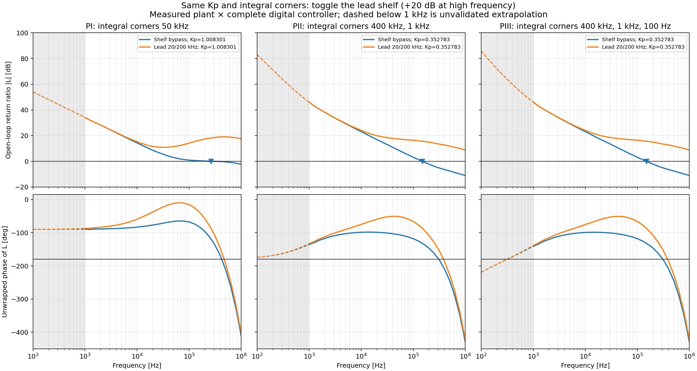
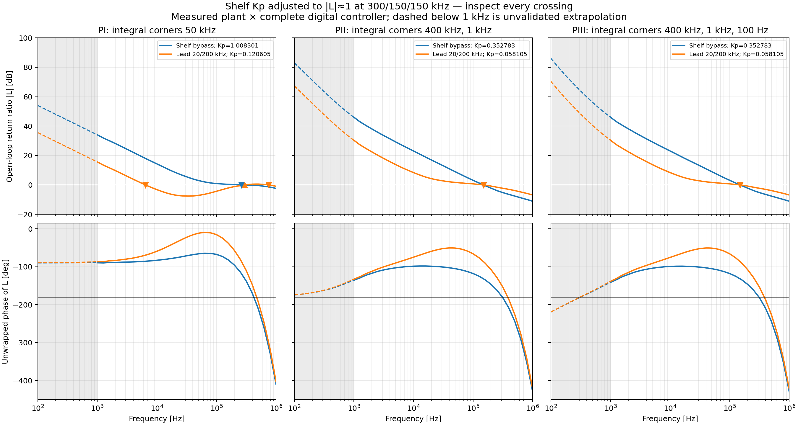
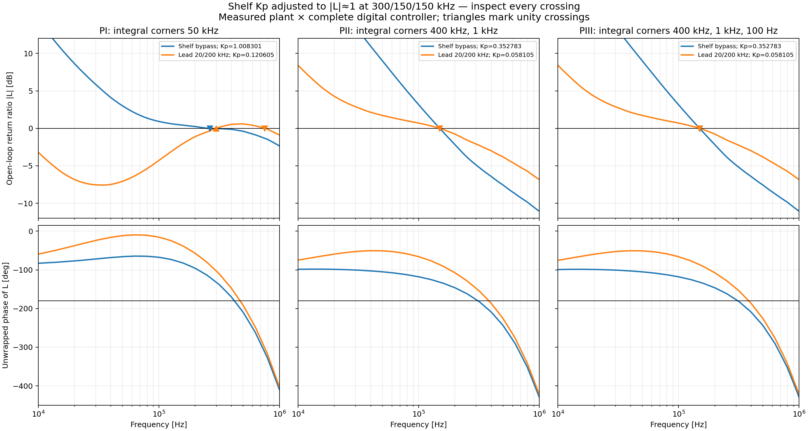

# Predicted open-loop return ratios

These are the full return ratios `L(f) = [K(f)/K0] C(f)`, not controller-only responses.
The plant is the measured intensity actuator→optical-sensor transfer in `intensity_loop_171424_945111.csv`.
The same local power-linearization assumption and calibrated AOM scale used for the presets are retained.

The blue curves bypass the shelf. Orange uses the same unity-DC lead shelf in every case:
`(1+s/(2π×20 kHz))/(1+s/(2π×200 kHz))`. It approaches a gain of10 (+20dB), so enabling it at unchanged Kp is a major gain change.

## 1. Fixed preset gains and corners

| Case | Actual Kp | Measured-band unity crossings: frequency, direction, local PM | High-frequency gain-increase margin |
|---|---:|---|---|
| fixed_gain_PI_bypass | 1.008301 | 263.95 kHz down, 60.9° | +0.19 dB at 422.5 kHz |
| fixed_gain_PI_lead | 1.008301 | None between 1 kHz and 1 MHz | -19.03 dB at 471.2 kHz |
| fixed_gain_PII_bypass | 0.352783 | 149.44 kHz down, 48.1° | +5.09 dB at 309.8 kHz |
| fixed_gain_PII_lead | 0.352783 | None between 1 kHz and 1 MHz | -12.81 dB at 381.3 kHz |
| fixed_gain_PIII_bypass | 0.352783 | 149.43 kHz down, 48.1° | +5.09 dB at 309.8 kHz |
| fixed_gain_PIII_lead | 0.352783 | None between 1 kHz and 1 MHz | -12.81 dB at 381.2 kHz |

At unchanged Kp all three shelf-enabled cases stay above unity through1MHz and have a negative gain-increase margin at their measured negative-real-axis crossing. These are unsuitable as simple drop-in settings. The data do not locate their eventual high-frequency unity crossover; no behavior beyond1MHz is asserted.

## 2. Reduce shelf Kp to set |L|≈1 at the nominal target

Only Kp changes here; each controller keeps its original integral corners. Coefficients are rounded to the actual Q12 gain register. Setting one frequency to unity does not guarantee a unique or stable crossover.

| Case | Actual Kp | All measured-band unity crossings | High-frequency gain-increase margin |
|---|---:|---|---|
| normalized_at_target_PI_lead | 0.120605 | 6.43 kHz down, 110.4°; 298.94 kHz up, 77.1°; 754.11 kHz down, -121.5° | -0.58 dB at 471.2 kHz |
| normalized_at_target_PII_lead | 0.058105 | 149.02 kHz down, 93.5° | +2.85 dB at 381.3 kHz |
| normalized_at_target_PIII_lead | 0.058105 | 149.01 kHz down, 93.5° | +2.85 dB at 381.2 kHz |

The PI50kHz-corner case crosses downward near6.4kHz, upward near300kHz, then downward again near754kHz. Its attractive local PM at the upward300kHz crossing is not a stable300kHz loop: the later down-crossing has negative PM and the measured phase-crossing margin is negative. PII/PIII with reduced Kp have one observed downward crossing near149kHz and much larger local phase margin, but gain margin falls from about5.1dB to2.85dB. They also give up low-frequency gain because Kp is reduced.

The separately exported `PI_lead_300k` preset additionally changes the PI corner from50kHz to300kHz. It is therefore not one of the fixed-corner toggles above. For reference:

| Different-corner comparison | Kp | Measured-band unity crossings | Gain-increase margin |
|---|---:|---|---|
| alternate_PI_300k_corner_lead | 0.086426 | 286.12 kHz down, 45.6° | +0.64 dB at 404.0 kHz |

## Registered-controller model and limits

The controller is evaluated from a two-phase lifted linear recurrence of the current RTL. It includes quantized Kp/integral/shelf coefficients, input registers before integral multipliers, alternate multiply/update clocks, registered integral sums, and shelf-state/output registers. The fundamental response is formed from both clock phases. An independent comparison against the bit-exact sequential reference agreed within1.03×10⁻⁶ relative complex error for tested PI/PII/PIII points with shelf on/off. Arithmetic rounding, saturation and anti-windup are omitted from the lifted small-signal model.

The common pure-P pipeline factor is removed from that recurrence before adding the full calibrated-path budget:11 clocks=44.759ns, or13 clocks=52.897ns with the shelf. Thus the main delay is included once. The measured plant already includes the INT2 receive filter and has effective delay1.087µs. Feedforward does not enter the fixed-operating-point return ratio.

Earlier preset JSON/README margins used the simpler product of half-rate PI factors plus the main delay. The refined relative-register model reduces the PI response magnitude only about0.31% around300kHz. Because its gain curve is almost flat near unity, that shifts its predicted crossing from299kHz to264kHz and changes local PM from48° to61°, while the gain-increase margin remains only about0.19dB. This is a sensitivity of the model, not a demonstrated hardware bandwidth change. The original large-dither FRA and calibration uncertainties are larger than this small magnitude difference; a new small-signal FRA must establish the actual crossing. PII/PIII predictions change much less. The programmed preset coefficients are unchanged.

Solid curves use log-frequency interpolation of measured complex plant data from1kHz to1MHz. Below1kHz, dashed curves use the fitted Gaussian magnitude and pure delay; this region is unvalidated. No high-frequency extrapolation is drawn. Low-frequency PIII phase crosses−180° upward in that extrapolated region. Its negative numerical gain margin denotes a lower gain boundary in the assumed model, not the high-frequency gain-increase margin; taking the minimum of all signed margins would be misleading. Crossing directions and measured/extrapolated provenance are retained in the CSV/JSON. Full stability requires the Nyquist topology and plant behavior outside the measured band, not a single local phase-margin number.

The CSV contains frequency, complexL, gain, unwrapped phase and a measured-band flag for every case. `open_loop_margins.csv` lists every crossing; `open_loop_predictions.json` records coefficients and model provenance. Regenerate with `python plot_open_loop_predictions.py` (NumPy, Pandas, Matplotlib). No hardware settings or preset files are modified.
